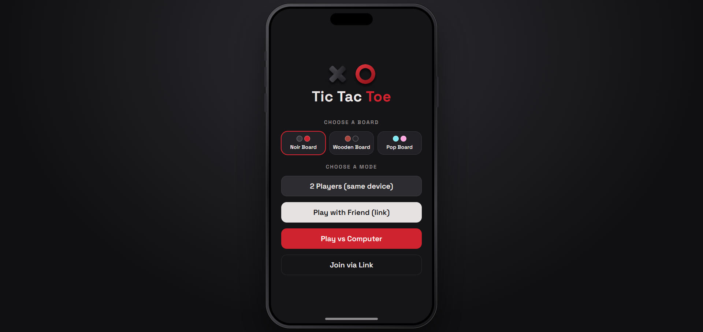
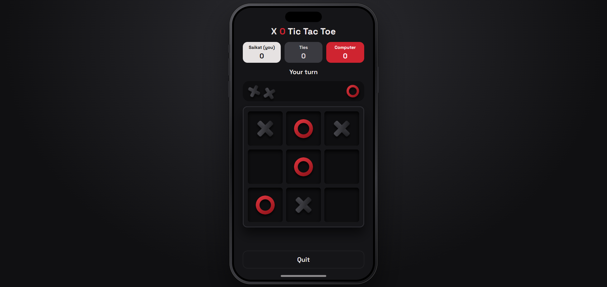

# X O Tic Tac Toe

A modern Tic Tac Toe game built with React and Vite, featuring three unique board themes and three different ways to play.

Play against the computer, challenge a friend on the same device, or invite someone online using a shareable game link.

## Game Preview

<p align="center">
  
  
</p>

<p align="center">
  <a href="https://tictactoesaikat.vercel.app/">
    <strong>Live Demo</strong>
  </a>
</p>

## Features

- Three game modes: Play vs Computer, 2 Players, and Play with Friend.
- Three visual themes: Noir, Wooden, and Pop.
- Interactive 3x3 game board.
- Remaining pieces displayed beside the board.
- Player names and score tracking.
- Automatic turn switching after each round.
- Match state preserved after page reload.
- Online multiplayer using PeerJS.
- Shareable invite links to join online matches.
- Responsive design with an iPhone-inspired interface.
- No account or sign-up required.

## Game Modes

| Mode | Description |
|---|---|
| Play vs Computer | Play against a computer opponent. |
| 2 Players | Two players take turns on the same device. |
| Play with Friend | Invite a friend and play online using a game link. |
| Join via Link | Join an existing online match using an invite link or game code. |

## Board Themes

| Theme | Description |
|---|---|
| Noir | A dark board with charcoal X and red O pieces. |
| Wooden | A wooden-style board with red X and black O pieces. |
| Pop | A colorful purple board with cyan X and pink O pieces. |

Players can select their preferred board theme from the home screen.

## How to Play

1. Select a board theme and game mode.
2. Enter your player name.
3. Players take turns placing their pieces in empty cells.
4. Get three pieces in a row horizontally, vertically, or diagonally to win.
5. If all nine cells are filled without a winner, the round ends in a draw.
6. Select Play Again to start another round.

### Piece System

- X starts with 5 pieces.
- O starts with 4 pieces.
- Remaining pieces are displayed beside the board.

## Online Multiplayer

The Play with Friend mode allows two players to play together over the internet.

1. Select Play with Friend.
2. Enter your name and create a game.
3. Copy the generated invite link.
4. Share the link with your friend.
5. Your friend opens the link and joins the match.
6. Once connected, both players can play in real time.

### Technical Details

- Uses PeerJS for peer-to-peer communication through WebRTC.
- No dedicated game server or database is required.
- The host should keep the game tab open during the match.
- Network restrictions may affect peer-to-peer connections.

## Run Locally

You can run this project on your computer using Node.js and npm.

### Prerequisites

- Node.js 18 or newer
- npm (included with Node.js)
- Git

### Installation

**1. Clone the repository**

```bash
git clone https://github.com/SaikatTalukder7/tic-tac-toe.git
```

**2. Navigate to the project directory**

```bash
cd tic-tac-toe
```

**3. Install dependencies**

```bash
npm install
```

**4. Start the development server**

```bash
npm run dev
```

**5. Open the application**

Vite will provide a local development URL, usually:

```text
http://localhost:5173
```

Open this address in your browser to play the game.

### Build for Production

Create an optimized production build:

```bash
npm run build
```

Preview the production build locally:

```bash
npm run preview
```

The generated production files will be available inside the `dist` directory.

## Deployment

This project is deployed using Vercel.

To deploy your own copy:

1. Fork or import this GitHub repository.
2. Visit [Vercel](https://vercel.com/).
3. Select Add New Project.
4. Import the `tic-tac-toe` repository.
5. Keep the default Vite build settings.
6. Click Deploy.

No environment variables are required for the current configuration.

## Project Structure

```text
tic-tac-toe/
|
|-- screenshots/
|   |-- home.png
|   `-- gameplay.png
|
|-- index.html
|-- package.json
|-- package-lock.json
|-- vite.config.js
|-- LICENSE
|-- README.md
|
`-- src/
    |
    |-- main.jsx
    |-- App.jsx
    |
    |-- game/
    |   |-- logic.js
    |   `-- session.js
    |
    |-- components/
    |   |-- Piece.jsx
    |   |-- Tray.jsx
    |   |-- Board.jsx
    |   |-- Scores.jsx
    |   |-- Match.jsx
    |   |-- ThemePicker.jsx
    |   `-- NameModal.jsx
    |
    |-- screens/
    |   |-- Home.jsx
    |   |-- CpuGame.jsx
    |   |-- LocalGame.jsx
    |   `-- OnlineGame.jsx
    |
    `-- styles/
        |-- base.css
        |-- board.css
        |-- phone.css
        |-- home.css
        |
        `-- themes/
            |-- noir.css
            |-- wood.css
            `-- pop.css

```

## Tech Stack

- **React 18** - User interface development.
- **Vite** - Development server and build tool.
- **JavaScript (JSX)** - Game functionality and application logic.
- **CSS3** - Styling, layouts, animations, and themes.
- **PeerJS** - Peer-to-peer online multiplayer communication.
- **WebRTC** - Real-time communication between players.
- **Vercel** - Deployment and hosting.

## License

This project is licensed under the MIT License. See the [LICENSE](LICENSE) file for details.